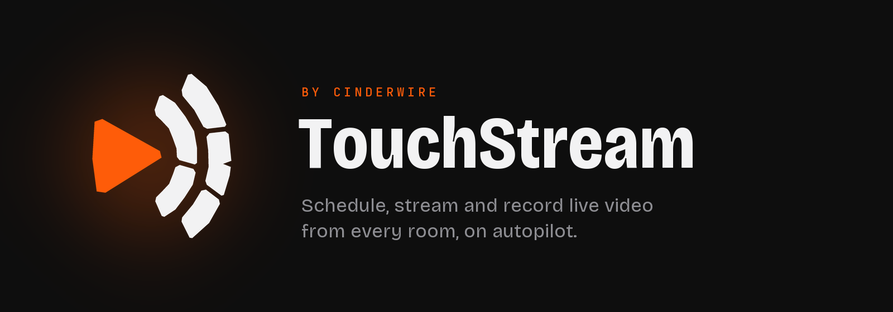
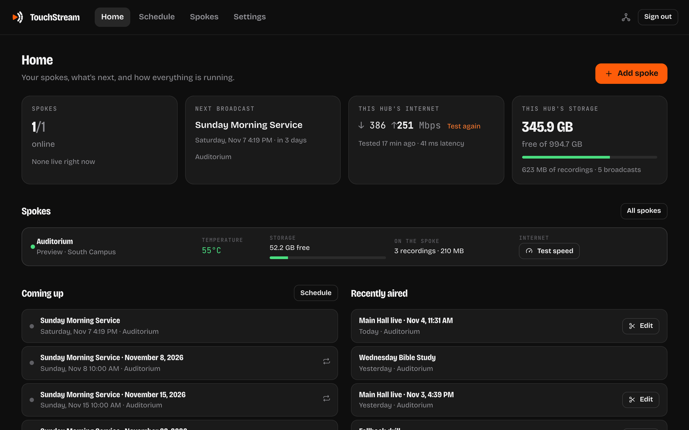
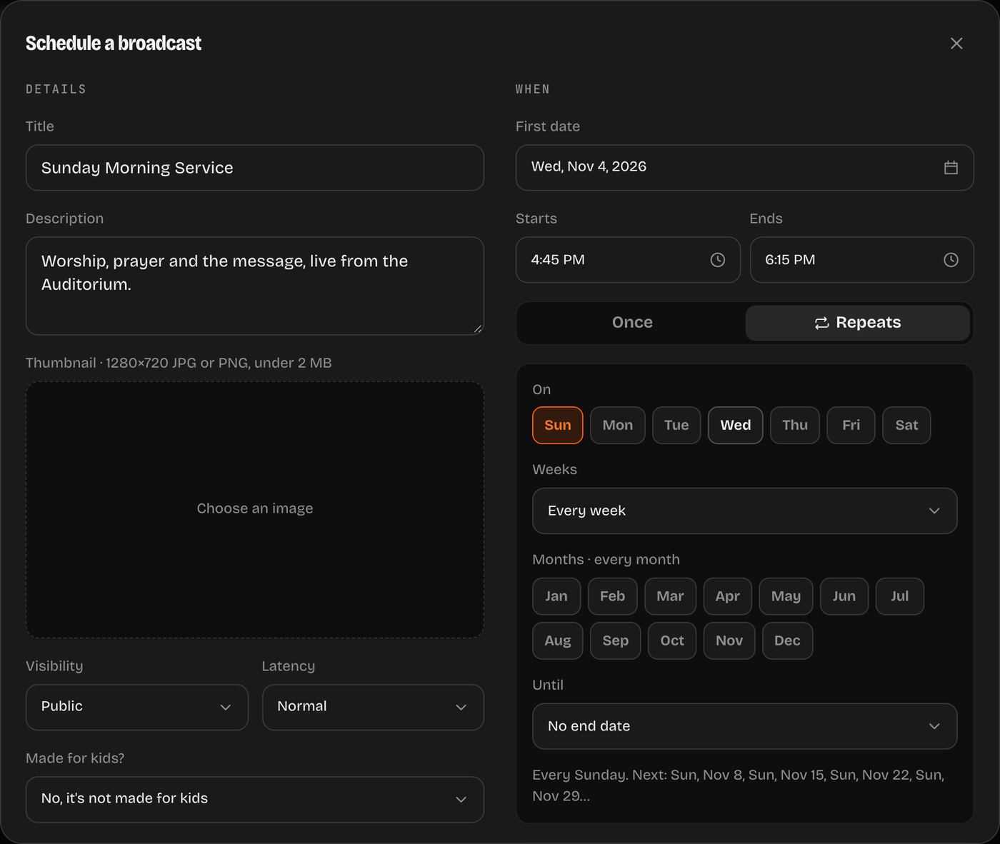
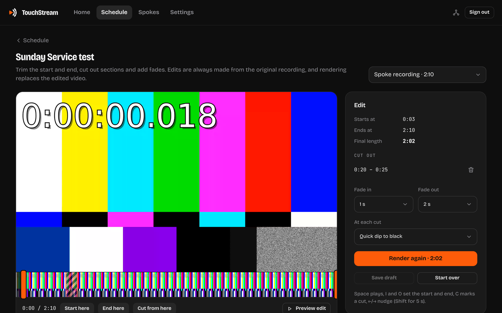
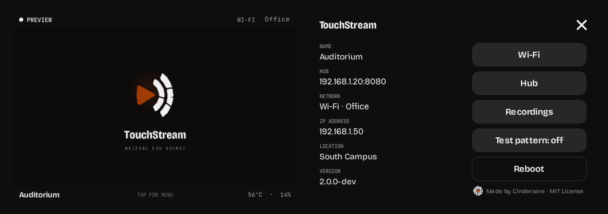

<p align="center">
  
</p>

<p align="center">
  <a href="LICENSE"></a>
  <a href="docs/hub.md"></a>
  <a href="docs/spoke.md"></a>
  <a href="docs/api.md"></a>
</p>

<h3 align="center">Plug a camera into a spoke. Schedule it once.<br>Every week it goes live on YouTube by itself, records, and files the video.</h3>

<p align="center"></p>

TouchStream is free, open-source live streaming for churches, schools and venues: the rooms where the same thing
goes out every week and the person running it isn't a broadcast engineer.

It has two parts:
- **The spoke**: a small off-the-shelf box with a touchscreen, next to your camera. Nothing to build.
- **The hub**: an app on any Mac, PC or server, which runs your schedule.

```
 camera ──HDMI──▶ spoke ──video──▶ hub ──▶ YouTube
                    │                │
          records its own copy    schedule · dashboard · recordings
          (nothing lost if the    editing · transcripts · AI assistant
          internet drops)
```

## What it does

- **Broadcasts on a schedule.** Once, or repeating ("Sundays at 10", "1st and 3rd Wednesday, June to August"). The
  hub creates each YouTube broadcast with its title, description and thumbnail, goes live on time and ends on time.
- **Records everything twice.** The hub records as the video arrives, and the spoke records its own copy and uploads
  it afterwards. Each broadcast gets a folder named for it, with the video, thumbnail, captions and details.
- **A real editor.** Video and audio tracks, cut and trim tools, gaps that stay until you close them, transitions,
  titles, a color layer, music, and brands with an intro, an outro and a watermark. Publish to YouTube as a new
  video and make the live one private.
- **Transcripts and captions,** made on your own computer. Nothing leaves it.
- **Shorts and reels.** Pick a moment by its sentences; TouchStream makes it vertical, follows the speaker, burns in
  captions with the spoken word lit, and takes out the pauses. Publish it as a YouTube Short.
- **An assistant on every page.** "Schedule our Sunday service every week at 10." "Cut the first ten minutes off
  Sunday's video." It asks before anything it can't undo. Bring your own OpenRouter key, or skip it.
- **Works with AI agents.** An MCP server and a documented API let Claude, n8n or your own scripts run the hub.
- **Go live from the room.** The spoke's screen has Go live, End and Record. Scan a recording's QR code to watch,
  trim and download it on your phone.

<table>
  <tr>
    <td width="50%"></td>
    <td width="50%"></td>
  </tr>
  <tr>
    <td align="center"><sub>Repeating broadcasts: pick the days, weeks and months</sub></td>
    <td align="center"><sub>Edit after the broadcast, always from the original</sub></td>
  </tr>
</table>

<p align="center"></p>
<p align="center"><sub>The spoke's screen: ready to go live, live, its recordings, and a QR code for your phone</sub></p>

## Get started

**1. Install the hub** on the computer that will run your broadcasts. One command does it all, with no Docker or
other software needed first:

| On | Run |
|---|---|
| **Mac** (Terminal) | `curl -fsSL https://raw.githubusercontent.com/Cinderwire-co/TouchStream/main/hub/install/macos.sh \| bash` |
| **Windows 10 or 11** (PowerShell) | `irm https://raw.githubusercontent.com/Cinderwire-co/TouchStream/main/hub/install/windows.ps1 \| iex` |
| **Linux** | `curl -fsSL https://raw.githubusercontent.com/Cinderwire-co/TouchStream/main/hub/install/linux.sh \| bash` |
| **A server** | Docker or Coolify: see [the hub guide](docs/hub.md#on-a-server) |

It starts the hub and opens the dashboard. Choose a password, and you're in.

**2. Get a spoke**: a Luckfox PicoKVM and a microSD card. The TouchStream installer puts the spoke's software on the
card, already paired with your hub. [The spoke guide](docs/spoke.md) (in development)

**3. Pair it**: in the dashboard, choose **Add spoke**. Spokes on your network show up by themselves.

**4. Connect YouTube** ([how](docs/youtube.md)), then **Schedule broadcast**. Without YouTube, TouchStream still
records every broadcast for you to download, edit and upload yourself.

## Guides

| | |
|---|---|
| [**The hub**](docs/hub.md) | Installing on a Mac, Windows, Linux, Docker or Coolify; updating; ports |
| [**Spokes**](docs/spoke.md) | The box, installing, its screen, recordings to phones, Wi-Fi, when the internet drops |
| [**YouTube**](docs/youtube.md) | Connecting your channels |
| [**Using TouchStream**](docs/using.md) | Scheduling, going live, editing, transcripts, the assistant, settings |
| [**AI agents and the API**](docs/api.md) | Letting Claude, n8n or a script run your hub |
| [**Roadmap**](docs/ROADMAP.md) | What's being built next |

## Developing

```bash
tools/dev up        # the hub from this checkout, a stand-in YouTube, and two emulated spokes
tools/dev status    # where they are, and the dev dashboard's password
tools/dev firmware  # Luckfox's PicoKVM images, from the zips of their Google Drive folder
tools/dev down
```

It needs uv, Go, Docker Desktop and FFmpeg, and keeps everything in `.dev/`. The dev hub has ports of its own
(its dashboard is http://localhost:8091), so it runs beside a hub installed on the same computer. See
[hub/](hub/README.md), [spoke/](spoke/README.md) and [installer/](installer/README.md) for each part.

## License

MIT: see [LICENSE](LICENSE). TouchStream and the TouchStream mark are made by [Cinderwire](https://cinderwire.co).
