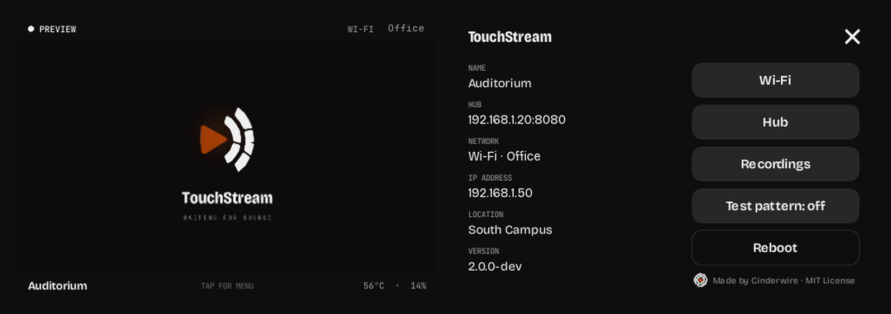

# Spokes

A spoke sits next to your camera or video switcher. It takes the HDMI output, sends the video to the hub, and records
its own copy while you're live. It's an off-the-shelf box, the **Luckfox PicoKVM**: nothing to build, nothing to
solder.

> **In development.** The spoke's software works end to end in an emulator: the hub link, streaming, recording and
> uploading, the screen, and recordings to phones. The parts that need the real box are being finished now: HDMI
> capture with its hardware encoder, HDMI sound, and the screen on the panel itself. To try it before then, see
> [spoke/README.md](../spoke/README.md).

## What you need

- **Luckfox PicoKVM**, the version with the 1.54" touchscreen (sold by Waveshare and others)
- A **microSD card**, 32 GB or more: the spoke's own recordings live on it
- A **USB-C power supply** (5 V, 2 A) and an **Ethernet cable**. The box has no Wi-Fi: see [Wi-Fi](#wi-fi).

The source should send **1080p** at 24, 25, 30 (29.97 is fine), 50 or 60 frames per second. Set the rate in the
spoke's settings in the dashboard; the spoke asks its HDMI source for it.

## Install

The TouchStream installer, for Mac and Windows, sets up the hub and then, for each spoke, writes the spoke's software
to a microSD card, already paired with your hub. Put the card in the box, plug in HDMI, Ethernet and power, and it
shows up in the dashboard.

You need a microSD card of 32 GB or more for each spoke (a "high endurance" card lasts longest), and a card reader if
the computer has no SD slot. The installer only offers removable cards, never the computer's own disks, and shows
what's on a card before it's erased. Writing a card asks for your password (on a Mac) or permission (on Windows).
Afterwards Windows may offer to format the card: choose **Cancel**, as it's written, Windows just can't read it.

Already have a hub? The installer can skip it and just make spoke cards. A spoke whose card wasn't paired (or one you
move to another hub) shows up under **Add spoke** in the dashboard, to adopt with one click.

## The screen

The home screen shows the spoke's name and whether it can reach the hub (the dot), what it's doing (**Set up**,
**Ready**, **No signal**, **Preview**, **Live** or **Recording**), what's coming in over HDMI, and the stream.

Along the bottom:

- **Recordings**: the recordings on the card, newest first. Drag to scroll, and tap one for its QR code.
- **Go live** (the round button with the broadcast sign) starts a broadcast right away, as **Go live** in the dashboard
  does, and **End** finishes it. End takes two taps, so a stray touch can't stop a broadcast. It needs an HDMI signal.
  Live, the spoke always records its own copy too.
- **Record** (the red button) records on the spoke, with or without a hub, without streaming. Stopping takes two taps
  too.

Whenever it's waiting on something, the line under the input says what: **Connecting to the hub…**, **Connecting to
YouTube…**, or **Can't reach the hub · retrying**.

## Without a hub

A spoke works on its own too. Tap the top of its screen for **setup**: a QR code for a page on your phone where you
add YouTube stream keys (from YouTube Studio: **Create** › **Go live** › **Stream**), pick the resolution, frame rate
and quality, name it, or connect it to a hub. **Go live** then streams straight to YouTube, and records a copy on the
card. Setup is only there without a hub: with one, its settings are in the dashboard.

A spoke with a hub keeps a copy of its schedule (the next week of broadcasts, and each one's stream keys), so it can
run on its own. If the hub can't be reached when a broadcast is due, or in the middle of one, the spoke streams it
straight to YouTube; if it can't stream at all, it still records it. It stops at the broadcast's end time, and the hub
takes over again when it's back.

## Recordings on a phone

Tap a recording, and scan its QR code with a phone on the same network. The spoke serves the page itself, so it needs
no internet: watch the recording, pick a start and an end, and download the clip or the whole thing. The first time,
the spoke makes a phone-friendly copy: about a minute per hour of video. A clip is copied at full quality, without
re-encoding, so it can only begin on a keyframe (one every 2 seconds): the start snaps to the nearest one, and the
clip begins exactly where it shows. For a frame-exact cut, use the editor in the hub.

A link keeps working for 30 minutes after it was last used. After that, show the QR code again.

## Sound

The spoke takes the sound that comes over HDMI with the picture. If the source sends its sound elsewhere (or sends
none), the stream carries silence and the picture is unaffected.

## Wi-Fi

The PicoKVM has only Ethernet. For a room without a network jack, use a pocket travel router as its Wi-Fi: the
router joins the venue's Wi-Fi, and the box plugs into the router's Ethernet port. One USB cable from the router for
both power and network is coming.

## When the internet drops

The spoke keeps recording its own copy, and uploads it when the hub is back. Each part uploads as soon as it's
finished, so little is left to send at the end. The spoke looks after its card: it keeps 2 GB free by deleting the
oldest recordings as new ones need the room, the ones the hub already has first. The one being recorded is never
touched. At the default quality (8 Mbps), 48 GB holds about 12½ hours.
